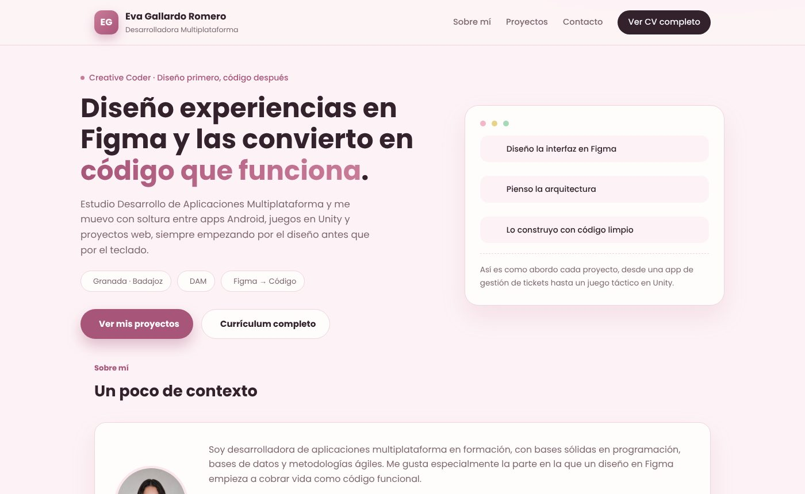
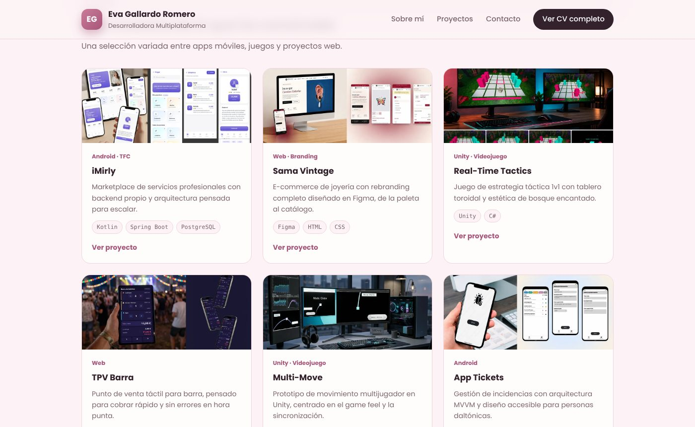
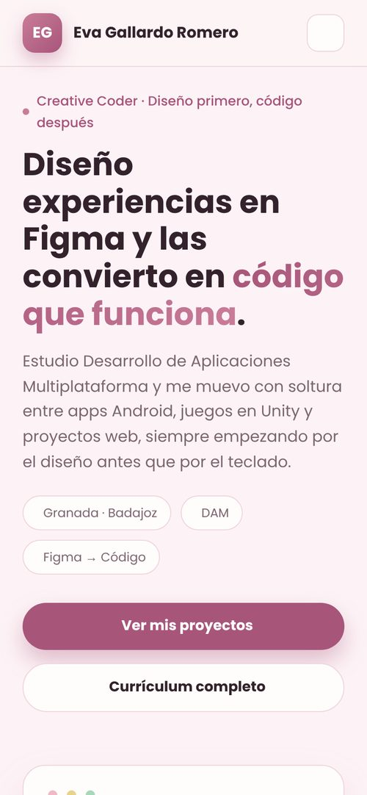

<div align="center">
  
</div>

<div align="center">
  <a href="https://github.com/evagr11/evagr11.github.io" target="_blank"></a>
  <a href="https://evagr11.github.io/" target="_blank"></a>
  <a href="https://evagr11.github.io/Curriculum/" target="_blank"></a>
</div>

<div align="center">
  <a href="https://git.io/typing-svg"></a>
</div>

# 🚀 Sobre el Proyecto

**evagr11.github.io** es mi página de presentación: una sola página para que quien llegue a mi perfil sepa en un minuto quién soy, qué hago y cómo contactarme. Es la versión **breve** a propósito; el detalle de cada proyecto, mi formación y mi experiencia están en el [portfolio completo](https://evagr11.github.io/Curriculum/).

<div align="center">
  
  <p><em>Portada de la página</em></p>
</div>

✨ **Características principales:**

*   👋 **Presentación directa:** Titular, una frase sobre cómo trabajo (*diseño en Figma, pienso la arquitectura, construyo*) y acceso al CV completo desde la cabecera.
*   🗂️ **6 proyectos destacados:** iMirly, Sama Vintage, Real-Time Tactics, TPV Barra, Multi-Move y App Tickets, cada uno con su imagen, tecnologías y enlace a su ficha en el portfolio.
*   🧰 **Con qué trabajo:** Kotlin/Android, Java, Spring Boot, SQL, Unity, Figma, Git y APIs REST.
*   📬 **Contacto:** Correo, LinkedIn, GitHub, itch.io y descarga del CV en PDF.
*   📱 **Responsive:** Menú lateral en móvil y cuadrícula de proyectos que pasa de 3 a 2 y a 1 columna.
*   ⚡ **Ligera:** Imágenes en WebP con carga diferida y etiquetas Open Graph para que el enlace se vea bien al compartirlo.

### Galería

| Proyectos destacados | Versión móvil |
| :------------------: | :-----------: |
|  |  |

# 🧠 Contexto del Proyecto

Tengo dos webs con objetivos distintos: esta, para una primera impresión rápida, y el [Curriculum](https://github.com/evagr11/Curriculum), donde está todo con detalle. Así quien solo quiere hacerse una idea no se pierde, y quien quiere profundizar tiene dónde hacerlo. Se publica directamente con **GitHub Pages** desde la rama `main`, en la dirección de mi usuario.

# 🛠️ Stack Tecnológico

<div align="center">
  
  
  
  
  
</div>

<br>

<div align="center">

| Área | Tecnología |
| :--- | :--------- |
| **Frontend** | `HTML5`, `CSS3` (variables, Grid), `JavaScript` (Vanilla) |
| **Iconos y fuentes** | `Font Awesome`, `Poppins` y `JetBrains Mono` |
| **Despliegue** | `GitHub Pages` |

</div>

# 📂 Estructura del Proyecto

```bash
evagr11.github.io/
├── index.html            # Toda la página
├── css/
│   └── estilos.css       # Variables de color al principio, luego cada sección
├── js/
│   └── menu.js           # Menú lateral en móvil
├── assets/
│   ├── cv/               # CV en PDF
│   ├── icons/            # Favicon
│   └── img/
│       ├── perfil/       # Foto
│       └── proyectos/    # Imágenes de las tarjetas (WebP)
├── .github/readme/       # Capturas de este README
└── README.md
```

# 🚀 Cómo Utilizar el Proyecto

### 1. Verla online

**[evagr11.github.io](https://evagr11.github.io/)**

### 2. Probarla en local

1.  Clona el repositorio:
    ```bash
    git clone https://github.com/evagr11/evagr11.github.io.git
    ```
2.  Navega a la carpeta del proyecto:
    ```bash
    cd evagr11.github.io
    ```
3.  Abre `index.html` en el navegador.

### 3. Añadir un proyecto

Copia una de las tarjetas `project-card` de `index.html`, cambia el texto y el enlace, y guarda su imagen en `assets/img/proyectos/` (en WebP y de 1000 px de ancho como máximo, para que la página siga cargando rápido).

<br>

<div align="center">
  <p>Creado por <strong>Eva Gallardo</strong></p>
  <a href="https://github.com/evagr11" target="_blank">
    
  </a>
  <a href="https://www.linkedin.com/in/eva-gallardo-romero-830362349/" target="_blank">
    
  </a>
</div>

<div align="center">
  
</div>
